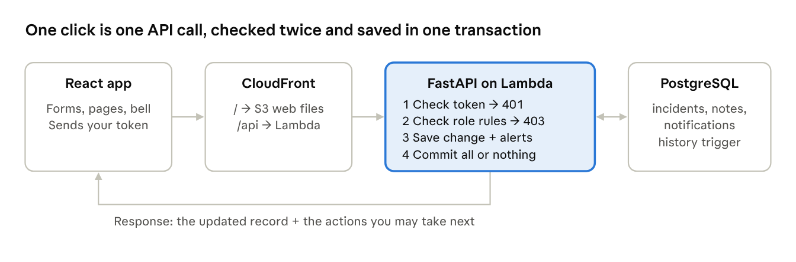
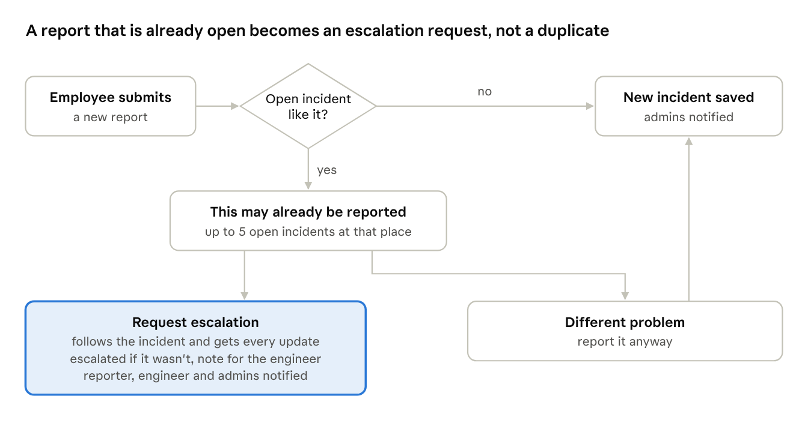
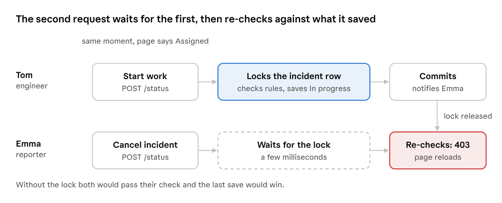
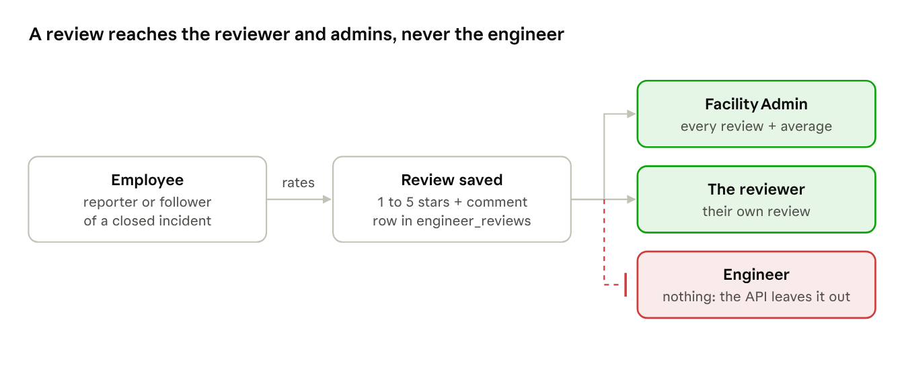

# How ACME Facility Desk Works

> **View in your browser:** [How ACME Facility Desk Works](https://claude.ai/artifact/4zg4HwDhZH7Agf9TZVPy6h) (live doc) · [Architecture page](https://claude.ai/artifact/5K5Hw9Gkc1Lg2SGG9JziYM)
>
> This file is a copy exported on 19 Nov 2026.

## The big picture

Here's the gist. Every click in the app turns into one API call, and every call runs through the same few steps. The React page sends the request. The API checks who you are and what you're allowed to do, then makes the change in PostgreSQL. In that same transaction it writes notifications for everyone else involved, then sends the updated record back. Dead simple, and that's the point.

Running it on your own machine? The dev proxy on port 3001 does CloudFront's job, and LocalStack runs the Lambda.

**The parts**

| Part | What it does | Where it runs (AWS / local) |
| --- | --- | --- |
| React app (Vite, Material UI, React Responsive) | Screens, forms, the notification bell. On phones the menu folds into a drawer and tables become cards | S3 behind CloudFront / Vite on :3000 |
| API (FastAPI) | Sign-in, role rules, the incident workflow, notifications | Lambda behind CloudFront at /api/api-service / LocalStack Lambda via the dev proxy |
| PostgreSQL | Users, buildings, incidents, notes, history, notifications | Aurora / local Postgres |

**Every request, in order**

1. The page calls the API with your sign-in token in the `Authorization` header.
2. The API strips off the `/api/api-service` prefix that CloudFront tacks on.
3. It reads the token and loads your user. No token, an expired one, or a disabled account? That's a **401**, and you're stopped right there.
4. It checks the role rules in `permissions.py`. If you're not allowed, you get a **403** and nothing changes.
5. It makes the change, adds the notifications and commits the lot together. If any part fails, none of it's saved.
6. A database trigger writes a history row for every incident change, with the name of whoever made it.
7. The API sends back the updated incident, along with the actions you're allowed to take next. The page uses that list to decide which buttons to show, so you're never offered something the server would turn down.

## Signing up and signing in

Anybody with an `@acme.inc` email can sign themselves up, and they always come in as an **Employee**. Engineer accounts are different: an admin has to make every one of them.

**Signing up** (`POST /auth/register`)

1. The form checks the email domain, that the password's at least 8 characters, and that both passwords match.
2. The API runs the same checks again and lowercases the email. If the request sneaks in a `role` field, it's ignored, so nobody can make themselves an admin. Catch yerself on.
3. The password's hashed with bcrypt before it's saved. The real password is never stored anywhere.
4. Already got an account with that email? You get a **409**: "An account with this email already exists."

**Signing in** (`POST /auth/login`)

1. The API finds your account and checks the password against its hash.
2. A wrong email and a wrong password get the exact same message, "Invalid email or password.", so nobody can go fishing for which emails are registered.
3. A disabled account gets a **403**.
4. If it all checks out, the API notes the sign-in time and hands back a signed token (a JWT) that's good for **8 hours**. The token carries your user id and your role.
5. The browser keeps it in `sessionStorage`, so closing the tab signs you out. The tab title changes to "\<your name> · ACME Facility Desk".
6. The page sends that token with every request after that (step 3 above).

**Staying signed in** (`POST /auth/refresh`)

1. Before each API call, the page checks how long the token has left. Under an hour, it quietly swaps it for a fresh 8-hour one first, and you're none the wiser. If several calls go out at once, they share the one renewal.
2. The API checks the token, reloads the user (so a changed role or a deactivated account kicks in straight away), and issues the new token with the **same** sign-in time.
3. A session ends 24 hours after you signed in, no matter what: renewal's refused, and the next expired token sends you back to sign in. That keeps a stolen token from being much use for long.
4. Because the bell calls the API every 30 seconds, an open tab stays signed in right up to that limit.

### How secure is signing in?

Short answer: sound enough. The passwords, tokens and role checks are solid, and nothing's known to be exploitable. The gaps are round the edges: a limit on login attempts is first on the list, then a stricter browser policy against script injection.

**What protects a sign-in**

| Protection | What it stops | Where |
| --- | --- | --- |
| bcrypt hash with a per-user salt (cost 10) | A leaked database revealing passwords | `app/core/security.py` |
| Unknown emails are checked against a dummy hash | Timing the response to learn which emails have accounts | `verify_password` |
| Token signed with a random 256-bit key, made at deploy time | Forging a token; the key is not in the code or the repo | `admin_tasks.py`, `app_secrets` table |
| Only HS256 accepted when checking a token | Tokens that claim another algorithm, or none | `decode_access_token` |
| User, role and active flag reloaded from the database on every request | A token outliving a role change or a deactivation | `app/api/deps.py` |
| 8-hour token, 24-hour cap from sign-in | A stolen token staying useful for long | `config.py` |
| HTTPS only (CloudFront redirects) | Reading the password or token on the network | `infra/cloudfront.tf` |

**Known gaps, the most important first**

1. **No limit on login attempts.** Nothing slows down somebody guessing passwords for one account, and the minimum is only 8 characters. The Lambda URL is public too (`authorization_type = "NONE"`), so a rate limit on CloudFront alone could be got round. Fix: a WAF rate rule on `/auth/login`, and only let CloudFront call the Lambda.
2. **Page scripts can read the token.** It sits in `sessionStorage`, and there's no Content-Security-Policy, so an injected script could copy it. React escapes what it shows, which takes a fair bit of the risk away. Fix: a CSP header, or an httpOnly cookie. The upside today: bearer tokens can't be used for cross-site request forgery.
3. **Signing out only clears the browser.** The server can't cancel a token, so a copied one keeps working until it expires (up to 24 hours with renewals). For now, the only way to cut it off is to deactivate the account.
4. **Wee things:** bcrypt cost is 10 (12 is the usual advice these days), there's no check against common or leaked passwords, and no second sign-in step.

## Reporting an incident

A new incident starts off **Open** and unassigned, and it gets a reference like `INC-000012`. Every Facility Admin hears about it.

1. **The form loads.** The page asks `GET /auth/me` for your usual building, then `GET /facilities` to fill the Building, Floor and Seat lists. If an admin has set a usual building for you and it's still active, the form starts on it, with a wee note saying you can change it. Pick a different building and the note changes to "This isn't your usual building (ACME Headquarters). That's fine if the problem is here." It's only a nudge in case you changed it by accident: the report goes through as normal, and the API never compares the two. Picking a building narrows the floors to that building, and picking a floor narrows the seats.
2. **You submit.** The form checks the required fields first: title, description, category and building. Then it sends `POST /incidents`.
3. **The API checks the request:**
   - Priority has to be Low, Medium or High. Only admins can choose Critical; an employee who tries gets a **400** and is told to escalate instead.
   - The floor has to belong to the building, and the seat has to be on that floor. None of them can be deactivated.
4. **The database saves it.** It creates the row with status `open` and builds the `INC-` reference from the id. A trigger logs a "created" history entry.
5. **Notifications go out** to every active admin, in the same transaction: "Alice reported INC-000012: Broken chair".
6. **The page opens your new incident** at `/incidents/12`.

## Already reported? Request escalation

Before a new report's saved, the app checks whether somebody's already reported the same thing. If they have, the employee can ask for that one to be escalated instead of reporting it twice. Saves everybody a bit of bother.

**What the employee sees:** after clicking Submit, a **This may already be reported** box lists the open incidents at that spot. Each one has a **Request escalation** button with an optional "Why is it urgent?" box. Or they can pick **It's a different problem, report it**, or head back to the form.

**What happens behind the scenes**

1. **The check** (`GET /incidents/similar`) looks for incidents in the same building and category that are still being worked on (open, assigned, in progress or on hold) and haven't been merged. If both have a floor, it has to match. It returns 5 at most, with no reporter name or description, and marks any that are already the caller's own or ones they follow.
2. **The request** (`POST /incidents/{id}/escalation-request`) runs in one transaction:
   - It turns away admins and engineers (403), the incident's own reporter (400, they should use Escalate), incidents nobody's working on any more (400), and a second request from the same person (409).
   - It locks the incident, then adds the employee as a **follower**, with the time they asked.
   - If the incident isn't escalated yet, it is now, with the reason "Liam Lee has the same problem and asked for it to be escalated". The history trigger records it under Liam's name.
   - It adds a note from Liam with his reason, so the engineer sees it.
   - It lets the admins, the engineer ("has the same problem and asked to escalate") and the original reporter know.
3. **The page opens the existing incident.** Liam sees "You're following this incident because you have the same problem and asked for it to be escalated", and the details panel lists him under **Asked to escalate**.

The original reporter still owns the incident: only they can confirm the fix, reopen it or cancel it. And if the check itself fails for any reason, it never blocks a report; the form just saves as normal.

## The incident life cycle

An incident goes **Open → Assigned → In progress → Resolved → Closed**, and it's the reporter who gets the final say. Each move is one API call, checked against your role, and it tells everyone involved except you.

Reopen an incident and it goes back to the engineer as In progress. For employees and engineers, Cancelled and Closed are final: once it's there, that's it. Only an admin can bring one back, and it comes back as Open with no engineer, ready to be assigned again.

| Step | Who | API call | What happens behind the scenes | Who is notified |
| --- | --- | --- | --- | --- |
| Escalate | Reporting employee | `POST /incidents/{id}/escalate` | Marks the incident escalated, stores the reason and time, and can record a requested higher priority. Allowed once, while the incident isn't resolved. | All admins, plus the engineer if assigned |
| Set priority / clear escalation | Admin | `PATCH /incidents/{id}` | Changes the priority or clears the escalation flag. The trigger logs a history entry. | Reporter and engineer (or the admins if no engineer yet) |
| Assign engineer | Admin | `POST /incidents/{id}/assign` | Rejects engineers who are inactive, on leave or offline (400), or already at their maximum active tickets (409). It locks the engineer's row while checking, so two admins can't fill the same last slot. Saves who assigned it and when. Open becomes **Assigned** automatically. | The engineer ("assigned to you"), the reporter ("is now working on"), and the previous engineer on a reassignment |
| Start work | Engineer | `POST /incidents/{id}/status` | Assigned becomes **In progress**. Any comment typed with the change is saved as a note. | Reporter |
| Put on hold / resume | Engineer | same | In progress and On hold swap. | Reporter |
| Resolve | Engineer | same | Sets `resolved_at`. | Reporter, asked to "confirm the fix or reopen it" |
| Confirm fix | Reporting employee | same | Resolved becomes **Closed** and `closed_at` is set. The incident is now read-only. | Engineer |
| Reopen | Reporting employee | same | Resolved goes back to **In progress** and the resolved time is cleared. | Engineer |
| Cancel | Reporting employee | same | Allowed while Open or Assigned. The page asks you to confirm first. | Engineer, or the admins if unassigned |
| Edit details | Employee while Open; admin any time before closing | `PATCH /incidents/{id}` | Re-checks the location and saves only the fields that changed. | Reporter and engineer, listing the changed fields |
| Delete | Admin | `DELETE /incidents/{id}` | Removes the incident with its notes and history. | Reporter and engineer (the alert has no link) |

Admins can make any status move, with two rules. An incident with no engineer can only stay Open or be Cancelled. And moving an incident back to Open, including reopening a cancelled or closed one, takes the engineer off it: Open always means "waiting for an engineer", so it shows as unassigned on the dashboard and gets assigned again with the usual capacity check. The engineer is told ("Alice Admin moved INC-000006 back to Open and took it off your list"), and History shows "Took Tom Tech off the incident". The database enforces both rules. Anything else gets a **403**: "You can't change this incident from X to Y."

## Two people acting at once

When an engineer and an employee do something to the same incident at the very same moment, neither change gets quietly overwritten. The second request waits for the first, then checks its rules again against what the first one saved.

**What happens behind the scenes**

1. **Every change locks the incident first.** Status changes, edits, assignment, escalation, notes, reviews and deletion all load the incident with a row lock (`get_incident_or_404(..., for_update=True)`). A second request on the same incident waits till the first one commits, usually just a few milliseconds.
2. **The rules are checked again after the wait.** By then the waiting request can see what the first one saved. So a cancel that lands just after "Start work" is refused with a **403** ("You can't change this incident from in\_progress to cancelled") instead of sneakily winning.
3. **Edits carry the version they started from.** The edit form sends `expected_updated_at`. If someone saved the incident in the meantime, the API answers **409** and nothing's saved. The page closes the form, shows the latest version and says "Your changes weren't saved: someone updated this incident while you were editing."
4. **A refused action refreshes the page.** After a 403 or 409 the incident reloads, so the buttons match how things really stand, and the message stays on screen even if the box it came from has gone.

| At the same moment | Result |
| --- | --- |
| Two notes | Both are saved |
| Edits to different fields (e.g. title and status) | Both are kept |
| Two status changes, or a status change and a cancel | The first wins; the second is re-checked and refused if no longer allowed |
| An edit saved after someone else's change | Refused with 409; the editor sees the new version |
| Two admins assigning an engineer's last slot | One succeeds, the other gets 409 "at full capacity" |
| An admin deactivating an engineer while another assigns them a ticket | Both lock the engineer's profile, so one waits. Assignment first: the deactivation is refused with 409 ("Reassign them first"). Deactivation first: the assignment is refused (the engineer is inactive) |

## Merging duplicate reports

When two employees report the same problem, an admin merges one report into the other. From then on there's one incident, one engineer and one fix, and both employees get every update. No more two engineers turning up for the one broken chair.

**What the admin does:** open the duplicate, pick an incident under **Merge duplicate**, and confirm. The list puts open incidents in the same building and category first. After the merge, the admin lands on the main incident.

**What happens behind the scenes** (`POST /incidents/{id}/merge`, one transaction):

1. The API locks both incidents, so two admins can't merge them at the same time. It won't merge an incident into itself, or merge one that's closed, cancelled or already merged.
2. The duplicate's reporter becomes a **follower** of the main incident (a row in `incident_followers`). So does anyone already following the duplicate.
3. Any duplicates merged into this one earlier get pointed at the main incident too, so chains fold up neatly.
4. The duplicate's closed as cancelled and linked with `merged_into_id`. The app labels it **Merged**, with a link to the main incident.
5. Two notes are added. The main incident gets the duplicate's title and description, so the engineer has the full picture. The duplicate gets "Merged into INC-…".
6. Notifications go to:
   - the duplicate's reporter, with a link to the main incident;
   - the main incident's reporter ("Liam reported the same problem");
   - its engineer, if one's assigned;
   - the duplicate's engineer, who no longer has that ticket on their list.

**What a follower can do**

|  | Original reporter | Follower |
| --- | --- | --- |
| See the incident in their list and dashboard | Yes | Yes |
| Get every update (assignment, status, public notes) | Yes | Yes |
| See internal notes | No | No |
| Add notes | Yes | Yes |
| Escalate, cancel, confirm the fix or reopen | Yes | No |

The follower sees a wee notice explaining why they can see the incident, and the main incident lists them under **Also reported by**.

## Rating the engineer

Once an incident's **Closed**, the employees who reported it can rate the engineer who fixed it: 1 to 5 stars, and a comment if they fancy. Admins use the ratings to see how engineers are getting on. Engineers never see them.

**What the employee does:** after confirming the fix, a **Rate Tom Tech** box appears on the incident. They pick the stars, add a comment if they like, and submit. They can edit or delete it later.

**What happens behind the scenes** (`POST /incidents/{id}/review`):

1. The API checks the caller is the reporter or a follower, that the incident's closed, and that an engineer actually worked on it. Admins and engineers get a 403.
2. It saves one row in `engineer_reviews` with the rating, the comment, the reviewer and the engineer at that moment. The database allows one review per person per incident; a second go gets a 409.
3. It returns the incident. Its reviews are filtered on the server by `visible_reviews()`: admins get every review, an employee gets their own, and an engineer gets an empty list.
4. No notification is sent, so nothing reaches the engineer that way either.

**Where admins see ratings:** on the incident (every review), and on the **Engineers** page, which shows each engineer's average and how many reviews it's from. Click the average to see all their reviews, each linked to its incident (`GET /engineers/{id}/reviews`, admin only).

|  | Reviewer | Other reporters | Facility Admin | Engineer |
| --- | --- | --- | --- | --- |
| Write a review (closed incident) | Yes | Yes, their own | No | No |
| See this review | Yes | No | Yes | No |
| See the average rating | No | No | Yes | No |
| Edit or delete it | Yes | No | No | No |

### What an engineer's browser receives

The hiding happens on the server, so an engineer who has a nosy at the browser's network tab finds no reviews or ratings in any response. Here's what each endpoint that could carry them gives an engineer:

| Endpoint | What an engineer gets |
| --- | --- |
| `GET /incidents/{id}` | `"reviews": []` |
| `GET /incidents` (list) | Nothing to hide: the list summary has no reviews field |
| `GET /engineers`, `GET /engineers/{id}`, `GET /engineers/{id}/reviews` | 403, admin only |
| `PATCH /engineers/me/availability` | Their own profile with `avg_rating` and `review_count` removed (`RATING_FIELDS`) |
| `GET /notifications` | No review notification is ever created |

An employee's response carries only the review they wrote; an admin's carries the lot. The test `test_engineer_never_sees_reviews` signs in as an engineer and checks every row above.

**Keep it that way:** the filter's applied by hand. Any new endpoint that returns incidents or engineer stats has to go through `visible_reviews()` or drop `RATING_FIELDS`, and should get a line in that test.

## Notes, notifications and the dashboard

Notifications are just rows in the database, not pushed messages. The bell asks the API for new ones every 30 seconds.

**Adding a note** (`POST /incidents/{id}/notes`)

1. Anybody who can see the incident can add a note, right up until it's Closed or Cancelled.
2. Engineers and admins can tick **Internal**. The API leaves internal notes out whenever an employee loads the incident, so employees never see them. Handy for talking about costs or suppliers.
3. A public note tells the reporter and the engineer. An internal note tells only the admins and the engineer.

**The notification bell**

1. Each notification is written in the same transaction as the change it's about, so you never get an alert for something that didn't actually happen.
2. You're never notified about your own actions.
3. Every 30 seconds the bell calls `GET /notifications/unread-count`, which only counts rows, and updates the red badge.
4. Opening the bell loads your latest 20 (`GET /notifications`). Clicking one marks it read and opens the incident.
5. **Mark all read** (`POST /notifications/read-all`) clears the badge. You can only read or mark your own.

**The dashboard** (`GET /dashboard`)

One call, and each role gets its own summary:

| Role | What the dashboard shows |
| --- | --- |
| Employee | Counts of their own incidents by status, and their recent incidents |
| Engineer | Their assigned tickets, their availability and remaining capacity, and a switch to change availability (`PATCH /engineers/me/availability`) |
| Admin | Counts across all incidents, a "Needs attention" list, each engineer's workload, and building, floor and seat totals |

## Admin actions

Only a Facility Admin can manage buildings and engineers. Anybody else gets a **403**, "You don't have permission to do that.", and never sees the admin menu or pages in the first place.

**Buildings, floors and seats** (`/buildings`, `/floors`, `/seats`)

1. **Create:** it goes building → floor → seat. A duplicate code or number under the same parent gets a **409**.
2. **Edit or deactivate:** a deactivated location stays on old incidents, but it's no longer offered on the new-incident form.
3. **Delete:** the database says no if any incident or engineer still uses the location. The API turns that into a **409**, "… Deactivate it instead.", so old incidents keep a valid location.

**Engineers** (`/engineers`)

1. **Create:** the API makes two linked rows in one transaction: a user with the Engineer role, and an engineer profile with their specialisations, availability, maximum active tickets and home building. The admin gives them their first password.
2. **Edit:** change their details, capacity or availability.
3. **Deactivate:** refused with a **409** while the engineer still has active tickets ("Reassign them first"), and you can't deactivate yourself. A deactivated engineer can't sign in, and any token they have stops working on the next request. The engineer's profile is locked while this is checked, the same lock an assignment takes, so a deactivation can't slip past an assignment landing at the same moment.

**People** (`/users`)

1. **The list** shows every account with its role, department, usual building and last sign-in. You can search by name or email, filter by role, and show inactive accounts too.
2. **Usual building:** pick one from the row and it saves straight away (`PATCH /users/{id}` with `home_building_id`; `null` clears it). It has to be an active building, and admins can set their own. When that person opens **Report incident**, the page asks the API for their account (`GET /auth/me`) and the form starts on that building, with a note saying so. Because it asks fresh each time, a change applies without signing in again. A deactivated building is ignored, and deleting a building clears it for everyone (`ON DELETE SET NULL`). The column comes from migration 006.
3. **Make admin / Make employee** turns an employee into a Facility Admin or back again. It kicks in on that person's next request, because every request reads the role from the database, and they get a notification.
4. **Deactivate** signs the person out on their next request and stops them signing in. **Reactivate** lets them back in.
5. **Safeguards:** you can't change your own role or deactivate yourself; engineers are managed on the Engineers page (their tickets and capacity rules live there); and there's always at least one active Facility Admin. If two admins demote each other at the same moment, the API locks the admin rows and refuses the second change with a **409**. Nobody locks the whole place out by accident.

## Install it as an app

The app's a **progressive web app (PWA)**, so Chrome, Edge and phones will offer to install it. It then opens in its own window with the ACME icon, like any other app.

- `manifest.webmanifest` sets the name, colours and icons.
- `sw.js`, a service worker, caches the app's files, so it opens in a flash and still loads offline (it then tells you it can't reach the server).
- The service worker **never caches `/api/` responses**: incident data is always live, and nothing private is left lying about on the device.
- Pages come from the network first, so a new deploy shows up on your next visit.

## Running on AWS

The same code runs on AWS: the React app on S3 behind CloudFront, and the API on Lambda, talking to Aurora PostgreSQL. The workshop scripts deploy it: `deploy-backend.sh aws`, then `deploy-frontend.sh aws`.

**Setting up the database.** Aurora has no public address, so the Lambda creates the tables itself. Someone with AWS credentials invokes it directly with a task; a web request can never set these off.

| Task | What it does |
| --- | --- |
| `status` | Are there tables? How many users, incidents and admins? Is the signing key set? |
| `init_db` | Empty database only: creates the tables, an admin (or the sample data) and a random 256-bit token-signing key |
| `migrate` | Runs every migration (each safe to repeat). Use it after deploying a version that adds tables or columns |

**What's different on AWS** (`IS_LOCAL=false`):

- the database connection needs TLS (`sslmode=require`);
- tokens are signed with the random key `init_db` stored in the database, not one worked out from settings;
- Aurora has a wee nap after 5 idle minutes, so the API keeps retrying the connection for up to 25 seconds while it wakes up. The first visit after a quiet spell takes a few seconds instead of failing, and that limit stays under CloudFront's 30-second timeout.

## Security checks on every push

GitHub runs three scans on every push and pull request:

- **Bandit** reads the Python code for risky patterns. A wee `backend/.bandit` file leaves out the tests folder, because tests use `assert` and fake passwords on purpose; the app code's scanned in full and comes up clean.
- **npm audit** checks the frontend's packages against known vulnerabilities and fails on anything high or critical. It found three critical advisories in Vitest 3, the test runner (never in anything users download), and Vitest 4 cleared them.
- **Checkov** reviews the Terraform in `infra/` and only reports.

Bandit and npm audit both pass, sound.

## When things go wrong

Every error comes back as `{"message": "..."}` in plain English, and the page shows it as it is. A failed request changes nothing at all, because the whole transaction's rolled back.

| Code | When it happens | What you see |
| --- | --- | --- |
| 400 | A rule or field check failed, such as a wrong location, a missing field or an invalid email | The reason in red directly above the field it's about, for example "That floor is not in the selected building." above Floor, and the cursor moves to the first one. Nothing appears at the top of the page. |
| 401 | No token, an expired token (after 8 hours), or a deactivated account | You are signed out and sent back to the login page. A wrong password does not sign you out; it just shows the error. |
| 403 | Your role isn't allowed to do this | "You can't change this incident from X to Y." or "You don't have permission to do that." |
| 404 | The incident doesn't exist **or** you aren't allowed to see it | "Incident not found." The same answer for both, so nobody can guess other people's incidents. On AWS, CloudFront swaps any 404 for the app's own page (status 200), so the app treats an HTML reply from the API as a 404. If you act on an incident that was just reassigned away from you, the page reloads and says it may have been reassigned or deleted. |
| 409 | A duplicate, or something still in use | "An account with this email already exists." or "… Deactivate it instead." |
| 503 | The database pool is full (waited 10 s) or the database is down | "The service is busy right now…" with a `Retry-After` header |
| 500 | An unexpected bug | "Something went wrong. Please try again." The details go to the server log, never to the browser. |
| none | The browser can't reach the API at all | "Cannot reach the server. Is the backend running?" |

## Why it's built this way

Most of these choices come down to two things. The workshop deploys to Lambda, which keeps no memory between requests and can't hold connections open. And an incident tool has to be one people can trust: the right folk see the right things, and nothing goes missing.

**Architecture**

| Decision | Why |
| --- | --- |
| React on S3 + CloudFront, one API on Lambda | This is the infrastructure the workshop provides. You pay only when it is used, and Lambda handles more traffic by starting more instances. |
| One API service instead of several | One codebase, one deploy and one database connection setup. The app is small enough that splitting it would add work without benefit. |
| FastAPI with Pydantic | Request checks are declared once on the data models. Bad input is rejected before our code runs, and the API documents itself at `/docs`. |
| PostgreSQL | The data is relational: incidents link to users, buildings, floors and seats. Constraints and triggers enforce the rules even if the API has a bug. |
| Middleware strips `/api/api-service` | The same code runs behind CloudFront, which adds the prefix, and behind the local proxy, which doesn't. |
| Layout switches by what fits, not by device: menu drawer below 960 px (1200 px for admins' six links), incident lists as cards below 960 px, the Engineers table as cards below 1100 px | An audit at 320, 375, 414, 600, 768, 1024, 1280 and 1920 px found the admin top bar spilling off a 1024 px screen and tables squeezed on tablets, so each breakpoint is where that part stops fitting. A browser test checks every page at four sizes and fails if a page or a table scrolls sideways. |

**Security**

| Decision | Why |
| --- | --- |
| JWT token instead of server sessions | Lambda instances share no memory, so a session stored on one would be unknown to the next. A signed token is checked anywhere without a lookup. |
| 8-hour token kept in `sessionStorage` | It lasts a working day. Closing the tab signs you out, which matters on shared office PCs. |
| bcrypt password hashes | They are slow to compute on purpose, so a leaked database can't be cracked quickly. |
| Role rules checked on the server, and `role` ignored on register | The browser can be tampered with. Nobody can make themselves an admin or reach a hidden button by editing the page. |
| Same message for a wrong email or password; 404 for incidents you can't see | Attackers can't learn which accounts or incident numbers exist. |
| Only `@acme.inc` emails | Only company staff can register. The check runs in the form, the API and the database. |
| Quiet token renewal, capped at 24 hours per sign-in | Nobody is thrown out mid-task after 8 hours, yet a stolen token stops working within a day. Each renewal re-reads the role and active flag, so admin changes apply quickly. |
| People page safeguards: not yourself, not engineers, never zero admins | An admin can't lock everyone out by accident or in a race. Engineers stay on the Engineers page, where their open tickets block deactivation. |
| Usual building is a starting point, not a rule | People report problems in other buildings all the time (a meeting room, a site they're visiting). The form starts on their usual building to save a step, and a soft note appears if they pick another, to catch an accidental change. A pop-up or a server check would only slow down real reports. |
| Database set-up as a Lambda task, plus a random signing key stored in the database | Aurora isn't reachable from outside AWS, and the key the app would otherwise derive on AWS comes from a guessable database password. Direct invocation needs AWS credentials, so the public site can't trigger it. |

**Workflow**

| Decision | Why |
| --- | --- |
| All role rules in one file, `permissions.py` | The API enforces them and the page shows buttons from the same list, so the UI never offers an action the API will reject. |
| The reporter confirms the fix before it closes | The person who had the problem decides whether it is solved, not the engineer. |
| Only admins set Critical; employees escalate | Otherwise everyone would choose Critical. Escalation lets an admin triage and approve. |
| Assignment blocks engineers on leave, offline or at full capacity | Tickets don't sit with someone who isn't working or is already overloaded. The limit is checked on the server against the \`engineer\_workload\` view, and full engineers are greyed out in the picker. |
| Internal notes | Engineers and admins can discuss costs or vendors without confusing the employee. |
| Moving back to Open takes the engineer off | Before, an admin moving a ticket back to Open left the engineer attached: it sat in their list with no buttons, didn't count toward their workload, and didn't show as unassigned either, so it could slip through the cracks. Now Open always means waiting for an engineer, and a database rule (migration 007) makes sure of it. |
| Deactivate instead of delete for locations and engineers | Old incidents keep a valid location and engineer. An engineer with open tickets must hand them over first, so no ticket is orphaned. |
| History written by a database trigger | No code path can forget to log a change. The API tells the trigger who is acting, so every entry names a person. |
| Readable `INC-000012` references | People can quote them over the phone or in email. The database generates them, so there are never duplicates. |
| Duplicates are merged: the copy is cancelled and its reporter follows the main incident | One problem gets one engineer and one fix, and nobody is left without updates. Only the original reporter confirms the fix, so that decision stays with one person. Cancelled (not a new status) is used because the database requires an engineer for every other status. |
| Reviews filtered on the server, never shown to engineers | Hiding them only in the UI would still send them to the engineer's browser. Filtering in one function (visible\_reviews) keeps employees' feedback honest. Each review stores the engineer at the time, so a later reassignment can't move a rating to someone else. |
| Light and dark mode with a sun/moon button, following the device until you pick | Both colour sets live in one theme file as CSS variables, so switching only flips a class on the page and nothing reloads. The choice is saved in the browser, and a tiny script applies it before the app starts, so the screen never flashes white. Tabs share the choice, and each applies what is saved now rather than the value a change event carries: Edge delivers those events late to background tabs, and replaying them made every tab flip back and forth. No server change was needed. |
| Errors shown above the field they're about, never in a banner at the top | People look at the field they just filled, not the top of the page, which may be scrolled away. The API names the field in the same errors list it uses for invalid input, so rule errors (a duplicate email, a full engineer) land in the right place too. Errors that name no field sit just above the button that was clicked. |
| Already-reported check before saving, with Request escalation instead of a duplicate | Stops duplicates at the source, so admins merge less, and the extra person still counts: the incident is escalated and they follow it. The match (same building, category and floor) is simple and predictable; the employee decides, and can always report anyway. The list shows no reporter or description, because employees otherwise only see their own incidents. One request per person stops repeated alerts. |

**Reliability**

| Decision | Why |
| --- | --- |
| Notifications saved in the same transaction as the change | An alert can't exist for a change that failed, and a change can't save without its alerts. |
| Bell polls every 30 s instead of a live push | Lambda can't keep a WebSocket open. A cheap count query every 30 s is close enough to live for incident updates. |
| Pool of 1+1 connections on Lambda, 10+30 on a server | Each Lambda instance serves one request at a time, so a big pool would waste Aurora's connection limit. The load test showed that 4 connections starved the server, failing 434 of 510 users; with the new sizes none failed. |
| 503 with `Retry-After` after 10 s | Users get a clear "busy" message instead of a page that hangs for 30 s. |
| Every error is `{"message": "..."}` | The page shows any error as it is, with no special cases, and stack traces never reach the browser. |
| Retry the database connection for up to 25 s on AWS | Aurora Serverless pauses when idle to save cost; without the retry, the first visit after a quiet spell failed. Tested on the live site: 200 in 6.6 s after 7 idle minutes. |
| Hand-written service worker that never caches the API | About 60 lines with no plugin to learn or update. App files are cached for speed and offline start; data always comes live, so nobody sees stale incidents or leaves private data on a shared device. |
| Lock the incident row on every change, plus a version check on edits | Without it, two requests could both pass their rule check on the same old status and the last save would win, which let a reporter cancel work already started. The lock makes concurrent changes run one at a time and costs a few milliseconds per incident; it never blocks other incidents. The version check stops an edit from overwriting a change made while the form was open. |
