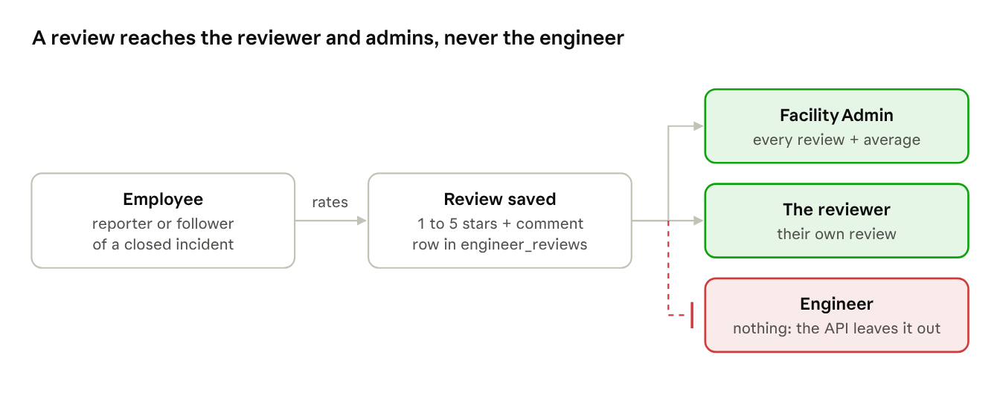
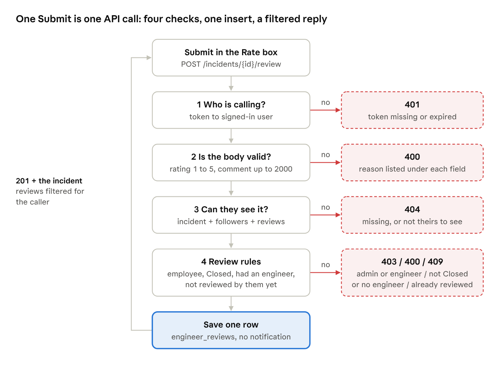

# Engineer Review Workflow

> **View in your browser:** [Engineer Review Workflow](https://claude.ai/artifact/SyVmrVTa7GLbbPi7XTmBov) (live doc)
>
> This file is a copy exported on 19 Nov 2026.

## Overview

Once an incident is **Closed**, the employees who reported it rate the engineer who fixed it: 1 to 5 stars and an optional comment. Admins see every review and each engineer's average. Engineers never see any of it.



| Who | Write a review | See reviews |
| --- | --- | --- |
| Reporter of the closed incident | Yes, one | Their own |
| Follower (their duplicate was merged into it) | Yes, one each | Their own |
| Facility Admin | No | Every review, plus averages on the Engineers page |
| Engineer | No | None, anywhere in the API |

The rule lives in one place, `app/services/permissions.py`, and every endpoint below calls it. The UI only shows what the API sends back, so it can't reveal a review the server didn't send.

## Writing a review, step by step

One click on **Submit review** is one `POST /incidents/{id}/review` call. It either saves one row and returns the updated incident, or changes nothing and returns an error.



Each check that fails stops the request and returns its error; nothing is saved. The numbered steps below follow the same order.

1. **The rating box appears.** When the incident page loads (`GET /incidents/{id}`), the response carries `permissions.can_review`. It is `true` only for a reporter or follower of a closed incident who hasn't reviewed it yet. The page shows the **Rate Tom Tech** box only when it is `true`.
2. **The employee picks stars and submits.** The Submit button stays disabled until a star is chosen. The page sends `{"rating": 4, "comment": "Quick fix."}`, with the comment trimmed, or `null` if it's empty.
3. **The API checks who is calling.** `get_current_user` reads the sign-in token from the `Authorization` header and loads the user. A missing or expired token, or a deactivated account, stops here with **401**.
4. **The API checks the body.** Pydantic (`ReviewIn`) requires a whole number from 1 to 5 and a comment of at most 2,000 characters, and trims the comment. A blank comment becomes `null`. Anything else is **400**, with the problem listed per field.
5. **The API loads the incident.** `get_incident_or_404` loads it with its followers and reviews in one query. If it doesn't exist, or the caller can't see it, the answer is **404** either way, so nobody can probe other people's incidents.
6. **The API checks the rules**, in this order:
   - Admins and engineers get **403** ("Only the employees who reported an incident can review its engineer.").
   - An incident that isn't Closed gets **400** ("You can review the engineer once the incident is closed.").
   - An incident that never had an engineer gets **400**.
   - If the caller already has a review here, **409** ("You've already reviewed this engineer. Edit your review instead.").
7. **The row is saved.** An `engineer_reviews` row gets the incident, the **engineer assigned at this moment**, the reviewer, the rating and the comment. The database also enforces one review per person per incident. If a double-click slips past step 6, the second insert fails that rule and the API turns it into **409**, not a crash.
8. **No notification is written.** Every other change in the app notifies someone; this one deliberately doesn't, so nothing reaches the engineer.
9. **The updated incident comes back** with **201**. Its `reviews` list is filtered for the caller (see *How engineers are kept out*), and `can_review` is now `false`. The page replaces the form with **Your review**, plus Edit and Delete buttons.

## Editing and deleting a review

Only the person who wrote a review can change or remove it. The API finds "your review" by matching the reviewer to the signed-in user, so no review id is ever sent and nobody can address someone else's.

**Edit** (`PUT /incidents/{id}/review`, or `PATCH`, which does the same)

1. **Edit review** fills the form with the current stars and comment. Save sends the whole review again, `{rating, comment}`.
2. The API runs the same sign-in and body checks as when writing (401 / 400) and loads the incident (404 if you can't see it).
3. It looks for the caller's own review on that incident. If there is none, the answer is **404**: "You haven't reviewed this incident's engineer yet." Admins and engineers never have one, so they always get 404 here.
4. It overwrites the rating and comment. A database trigger sets `updated_at`, while `created_at` and the engineer stay as they were.
5. It returns **200** with the updated incident.

**Delete** (`DELETE /incidents/{id}/review`)

1. **Delete** asks "Delete your review?" first.
2. The API finds the caller's own review (**404** if none) and deletes that row.
3. It returns **204** with no body, so the page reloads the incident (`GET /incidents/{id}`). `can_review` is `true` again, so the empty form returns and the employee can review again.

Neither action sends a notification.

## How admins see reviews

Admins see reviews in two places: on each incident, and on the **Engineers** page as an average per engineer with a list behind it.

**On the incident** (`GET /incidents/{id}`)

- The response's `reviews` list holds every review of that incident, with the reviewer's and the engineer's names.
- The page shows an **Engineer reviews (n)** section, read-only: "Emma Employee rated Tom Tech", stars, comment and when.

**On the Engineers page** (`GET /engineers`, admin only)

1. The engineer list query joins a per-engineer summary of `engineer_reviews`: `round(avg(rating), 1)` and `count(*)`, grouped by engineer.
2. Each engineer comes back with `avg_rating` (for example `4.3`, or `null` if never reviewed) and `review_count`.
3. The **Rating** column shows the stars and the number, or "No reviews".

**An engineer's reviews** (`GET /engineers/{id}/reviews`, admin only)

1. Clicking the average calls this endpoint. It returns **404** if the engineer doesn't exist.
2. It loads that engineer's reviews, newest first, each with its reviewer and its incident (reference and title) in the same query.
3. The page opens a **Reviews of Tom Tech** panel; each review links to its incident.

The average is computed by the database on every request, never stored, so editing or deleting a review changes it immediately.

## How engineers are kept out

Reviews are removed on the server before a response is built, so an engineer's browser never receives them. Hiding them only in the page would not be enough: anyone can open the browser's network tab.

| Path a review could leak through | How it's closed |
| --- | --- |
| The incident they worked on (`GET /incidents/{id}`) | `visible_reviews()` returns an empty list for engineers, so `reviews` is `[]` |
| The incident's actions (`permissions`) | `can_review` is always `false` for engineers |
| The engineer list and its averages (`GET /engineers`) | Admin-only route: engineers get **403** |
| An engineer's review list (`GET /engineers/{id}/reviews`) | Admin-only route: **403** |
| Their own profile, returned when they change availability (`PATCH /engineers/me/availability`) | `avg_rating` and `review_count` are removed from the response |
| Notifications | Writing, editing or deleting a review sends none |
| The incident list (`GET /incidents`) | The list summary has no reviews field at all |
| One engineer's profile (`GET /engineers/{id}`) | Admin-only route: **403** |
| Writing a review themselves | **403** |

`visible_reviews(user, incident)` is the single filter for the incident view: admins get every review, an employee gets only their own, and an engineer gets nothing. Employees don't see each other's reviews either, for example a follower can't read the original reporter's.

So an engineer who opens the network tab sees `"reviews": []`, 403s, and a profile without `avg_rating` or `review_count`. An employee sees only the review they wrote. The test `test_engineer_never_sees_reviews` in `tests/integration/test_reviews.py` signs in as an engineer and checks every read path in the table; `test_only_the_reporters_may_review` covers an engineer trying to write one.

**Keep it that way:** the filter is applied by hand, endpoint by endpoint. A new endpoint that returns incidents or engineer stats must go through `visible_reviews()` or drop `RATING_FIELDS` (`app/api/routes/engineers.py`), and should get a line in that test.

## API reference

All routes are under `/api/api-service` and need a sign-in token. Errors always come back as `{"message": "..."}`; a 400 for bad input also lists `errors: [{loc, msg}]` per field.

| Endpoint | Who | Body | Success | Errors, in the order they're checked |
| --- | --- | --- | --- | --- |
| `POST /incidents/{id}/review` | Reporter or follower of a closed incident | `{rating: 1-5, comment?: text ≤ 2000}` | **201** + incident | 401 not signed in · 400 bad body · 404 can't see incident · 403 admin or engineer · 400 not closed · 400 no engineer · 409 already reviewed |
| `PUT` / `PATCH /incidents/{id}/review` | The reviewer | same as POST | **200** + incident | 401 · 400 bad body · 404 can't see incident · 404 no review of yours |
| `DELETE /incidents/{id}/review` | The reviewer | none | **204** | 401 · 404 can't see incident · 404 no review of yours |
| `GET /incidents/{id}` | Anyone who can see the incident | none | **200**, `reviews` filtered for the caller, `permissions.can_review` | 401 · 404 |
| `GET /engineers` | Admin | none | **200**, each with `avg_rating`, `review_count` | 401 · 403 |
| `GET /engineers/{id}/reviews` | Admin | none | **200**, reviews newest first, each with `incident_reference` and `incident_title` | 401 · 403 · 404 no such engineer |

A review in a response looks like this:

```json
{
  "id": 7,
  "engineer_id": 4, "engineer_name": "Tom Tech",
  "reviewer_id": 6, "reviewer_name": "Emma Employee",
  "rating": 4, "comment": "Quick fix.",
  "created_at": "2026-11-19T09:12:00Z", "updated_at": "2026-11-19T09:12:00Z"
}
```

The code: routes in `app/api/routes/incidents.py` (bottom, "reviews") and `engineers.py`; rules in `app/services/permissions.py`; body and response shapes in `app/schemas/incident.py`; tests in `tests/integration/test_reviews.py`.

## Data stored and database rules

Each review is one row in `engineer_reviews`. The database enforces the hard rules itself, so even a buggy API couldn't store a bad review.

| Column | Holds | Rule the database enforces |
| --- | --- | --- |
| `id` | Review id | Generated |
| `incident_id` | The closed incident | Must exist; the review is deleted with the incident |
| `engineer_id` | The engineer assigned when the review was written | Must be an engineer profile |
| `reviewer_id` | The employee who wrote it | Must be a user; one review per reviewer per incident (`UNIQUE (incident_id, reviewer_id)`) |
| `rating` | 1 to 5 | `CHECK (rating BETWEEN 1 AND 5)` |
| `comment` | Optional text | At most 2,000 characters |
| `created_at`, `updated_at` | When written, last changed | `updated_at` is set by a trigger on every edit |

- An index on `(engineer_id, created_at)` keeps the averages and the newest-first list fast.
- The table was added by `backend/db/migrations/003_engineer_reviews.sql`, which only adds things and is safe to re-run. `schema.sql` includes it for new databases.
- The sample data (`seed.sql`) has one review: Emma gives Priya 5 stars for the broken chair.

## Why it's built this way

| Decision | Why |
| --- | --- |
| Only after the incident is Closed | The employee has confirmed the fix, so they're rating finished work. A cancelled or merged report had no fix to rate; that reporter rates the main incident instead. |
| Filter on the server, not in the page | Anything sent to the browser can be read in its developer tools. If the server never sends it, the engineer can't see it. |
| One filter function, `visible_reviews()` | One place to read and test the rule. The incident view, permissions and tests all rely on it. |
| Employees see only their own review | Reviews are candid feedback for admins, not a public score. Letting co-reporters see each other's would be a one-line change. |
| Store the engineer at the time of the review | If an admin later reopens and reassigns the incident, the rating stays with the engineer who did the work. |
| No notification | A "you got a review" alert would tell the engineer it exists. |
| "Your review" found by the signed-in user, no review id in the URL | Nobody can edit or delete someone else's review by guessing an id. |
| One review per person per incident, enforced by the database | Stops double-clicks and repeat ratings that would skew the average. The API turns the database error into a clear 409. |
| Average computed on each request, not stored | It can never go stale after an edit or a delete, and the data is small enough to compute quickly. |
