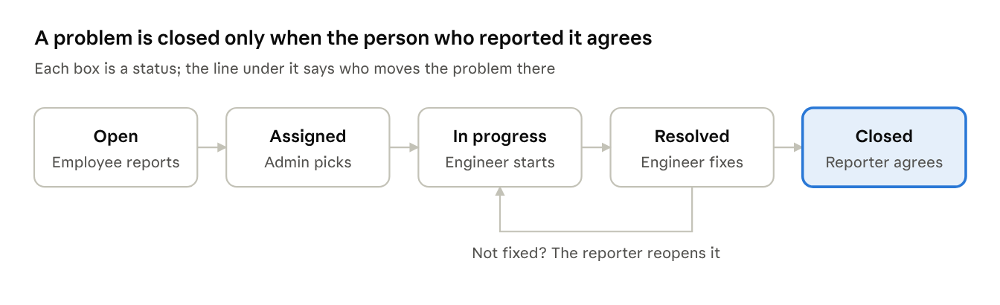

# ACME Facility Desk: A Simple Guide

> **View in your browser:** [ACME Facility Desk: A Simple Guide](https://claude.ai/artifact/2WkYhtV276bDhJCe8zQMBt) (live doc)
>
> This file is a copy exported on 19 Nov 2026. For the technical details, see [how-it-works.md](how-it-works.md).

## What it is

ACME Facility Desk is where ACME staff report problems in the office, like a broken chair, a leaking tap or a dead light. A Facility Admin hands each problem to an engineer, the engineer fixes it, and the person who reported it confirms the fix.

Everyone can see where their problem stands at any time, and the app tells the right people whenever something changes. It works in a browser, on a phone, and as an app you can install.

## Who uses it

There are three kinds of user. Each one sees only the screens and buttons for their job.

| Role | Who they are | What they do |
| --- | --- | --- |
| **Employee** | Any ACME staff member with an @acme.inc email. They sign up themselves. | Report problems, follow their progress, add notes, confirm the fix, and rate the engineer |
| **Engineer** | Maintenance staff. An admin creates their account. | See the jobs given to them, start and finish work, add notes, and say when they're available |
| **Facility Admin** | The people who run the help desk | See every problem, set priorities, assign engineers, merge duplicates, and manage buildings, engineers and people |

## What you can do

| Feature | In plain words |
| --- | --- |
| **Report a problem** | Pick the building, floor and seat, describe the problem, and send it. If an admin has set your usual building, it's already filled in. It gets a number like INC-000012. |
| **"Already reported?" check** | Before saving, the app shows open problems at the same place. If yours is there, you can join it instead of reporting it twice. |
| **Track progress** | Each problem shows its status, who is fixing it, and everything that happened to it. |
| **Notes** | Anyone involved can add a note. Engineers and admins can also write internal notes that employees don't see. |
| **Notifications** | A bell with a red badge tells you when something changes on your problems. You're never notified about your own actions. |
| **Dashboard** | A home page that fits your role: your own problems, your jobs, or the whole picture for admins. |
| **Escalate** | Mark a problem as urgent and say why, so admins look at it first. |
| **Rate the engineer** | After a fix, give the engineer 1 to 5 stars. Only admins see the ratings; engineers never do. |
| **Admin tools** | Manage buildings, floors and seats, engineer accounts, who is an admin, and each person's usual building. |
| **Install as an app** | Chrome, Edge and phones can install it so it opens in its own window. |

## The main workflow: from report to fix

Every step sends a notification to the people involved. The reporter can cancel while the problem is still Open or Assigned, and an engineer can put the work on hold and resume it later.

## Other workflows

**Someone already reported it**

1. You fill in the form and press Submit.
2. The app shows open problems in the same building and category.
3. You press **Request escalation** on the matching one and say why it's urgent.
4. You now follow that problem and get its updates. It's marked urgent, and the engineer sees your reason.

**Two people reported the same thing**

1. An admin spots the duplicate and merges it into the main problem.
2. The duplicate closes with a link to the main one.
3. Both people now get every update on the main problem. Only the first reporter can confirm the fix.

**Rating the engineer**

1. After you confirm the fix, a **Rate** box appears.
2. You give 1 to 5 stars and an optional comment. You can change or delete it later.
3. Admins see each engineer's average on the Engineers page. The engineer never sees it.

**Managing people (admins)**

1. Create engineer accounts and set how many jobs each can hold at once.
2. Make an employee an admin, or back again.
3. Turn off an account. That person is signed out on their next click and can't sign in.
4. The app always keeps at least one admin, and an engineer with open jobs can't be turned off until they're reassigned.

**Two people act at the same moment**

The second action waits a moment, then checks again. If the first one changed things, the second is refused with a clear message, so nobody's change is lost without them knowing.

## Keeping accounts safe

- **Passwords are never stored as typed.** They are scrambled one way (bcrypt), so even the database doesn't hold the real password.
- **Signing in gives you a pass (a token).** Your browser shows it with every click, so you don't type your password again. The server checks that the pass is genuine each time.
- **Passes run out.** A pass lasts 8 hours and is renewed quietly while you work. After 24 hours you sign in again. Closing the tab signs you out.
- **The server decides what you may do.** Your role is checked on every click, so an account that is turned off or changed takes effect at once.
- **Wrong email or wrong password give the same message**, so nobody can find out who has an account.

Still to add: a limit on repeated login attempts. The technical details are in [How ACME Facility Desk Works](how-it-works.md).
